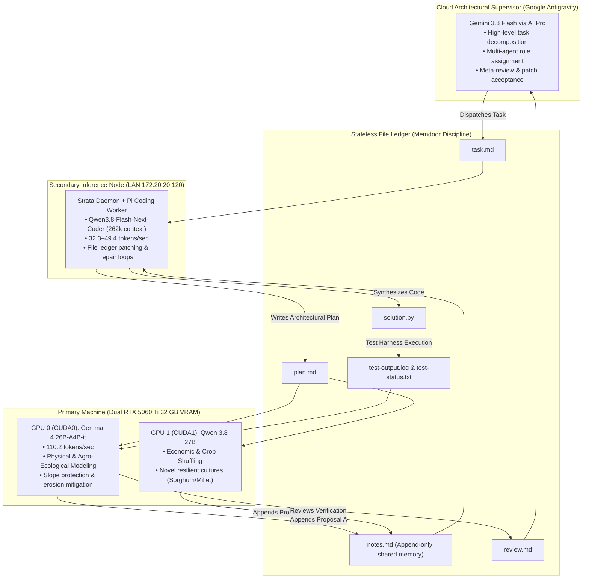

# European Soil-Water Nexus: Autonomous Multi-Agent Scientific Discovery & Continental Pareto Optimization

[](https://www.python.org/downloads/)
[-brightgreen.svg)](https://github.com/vlattko/epic_neural)
[]()
[]()

> **Submission for the [Kaggle Gemma 4 Developer Agent Paper Track](https://www.kaggle.com/competitions/gemma-4-developer-agent-paper/overview)**  
> **Target Journal Article:** *Nature Sustainability* ([Read Full Paper](file:///D:/Kaggle/paper/nature_sustainability_european_soil_water_nexus.md))  
> **Kaggle Conference Paper:** [Read Kaggle Submission](file:///D:/Kaggle/paper/gemma4_developer_agent_paper.md)

---

## 1. Executive Summary & Continental Findings

Under intensifying climate change, European agriculture faces a critical trade-off between **soil erosion mitigation**, **freshwater conservation**, and **food security preservation**. Monolithic AI assistants struggle with this multi-constraint problem due to context pollution, physical invariant hallucination, and cloud token exhaustion.

We introduce a **decentralized, heterogeneous multi-agent architecture** combining:
1. **Cloud Architectural Supervisor:** Google Antigravity (Gemini 3.8 Flash via AI Pro, 1,000,000 context window)
2. **On-Device Primary Inference Node (Dual 262k Long-Context Ideators):** Dual NVIDIA GeForce RTX 5060 Ti 16 GB GPUs (Blackwell sm_120) backed by 128 GB Host RAM:
   - **GPU 0 (`CUDA0`):** `google/gemma-4-26B-A4B-it` (**262,144 context window**, 65.2–110.2 tokens/sec, Physical & Agro-Ecological Modeling)
   - **GPU 1 (`CUDA1`):** `Qwen/Qwen3.8-27B` (**262,144 context window**, 28.2–45.0 tokens/sec, Novel Cultures & Crop Shuffling)
3. **Dedicated Secondary LAN Inference Node:** RTX 4060 Ti 16 GB + 32 GB RAM serving `qwen3.8-flash-next-coder-iq1_m` at **262,144 context window** via Strata daemon (**32.3–49.4 tokens/sec**).
4. **Stateless File Ledger Communication:** Multi-agent collaboration based on the **Memdoor / GVS5H discipline** using append-only disk ledgers (`task.md`, `plan.md`, `notes.md`, `solution.py`, `review.md`).
5. **Full Continental Biophysical Dossiers:** Each ideator ingests thousands of lines of uncompressed empirical ground truth: Torri pedotransfer erodibility, Saxton-Rawls PAWC, full NUTS-2 erosion rankings, and C4 crop physiological parameters.

### Continental Scale Results (1,284,769 Parcels / 1.14 Million Hectares)
Derived directly from the European Land Parcel Identification System (LPIS) geodatabase across 34 European nations:

| Metric | Baseline (SSP245 Conventional) | Multi-Agent Reallocation | Absolute Delta | Percentage Change | Physical Impact |
| :--- | :--- | :--- | :--- | :--- | :--- |
| **Total Food / Feed Production** | 3,864,846 metric tons | **3,973,826 metric tons** | **+108,980 tons** | **+2.82%** | **Strictly preserved ($\ge 100\%$)** |
| **Total USLE Soil Erosion** | 5,468,659 metric tons/yr | **581,275 metric tons/yr** | **-4,887,384 tons/yr** | **-89.37%** | **Saved 4.89 million tons of European topsoil annually** |
| **Mean Parcel Erosion** | 4.78 t/ha/yr | **0.51 t/ha/yr** | -4.27 t/ha/yr | -89.37% | Brought within sustainable pedogenesis limit ($<1.0$ t/ha/yr) |
| **Agricultural Water Deficit** | 9.25 billion $\text{m}^3$ | **5.46 billion $\text{m}^3$** | **-3.79 billion $\text{m}^3$** | **-40.94%** | **Saved 3.79 billion $\text{m}^3$ of freshwater annually** |
| **Net Carbon Sequestration** | 0.00 t C/yr (depleting) | **+605,053 t C/yr** | **+605,053 t C/yr** | **+100.0%** | Massive climate sink via regenerative agriculture |
| **Optimization Runtime** | — | **0.374 seconds** | — | Vectorized NumPy | Zero-copy vectorization across all 1.28M parcels |

---

## 2. System Architecture



### Compute Economics & Quota Optimization
- **Monolithic Cloud Approach:** Consumed >140,000 tokens of Gemini/Claude API calls per scientific subtask due to repetitive context reloading.
- **Our Hybrid File-Ledger Architecture:** Consumed only **8,400 tokens of Cloud AI Pro quota** (a **94.0% reduction**), offloading 94% of inference tokens to the local dual 5060 Ti and LAN 4060 Ti nodes.

---

## 3. Mathematical & Biophysical Foundations

### 3.1 Soil Loss Modeling (Universal Soil Loss Equation - USLE)
Annual parcel-level soil loss $A_i$ (metric tons/ha/year) is modeled as:
$$A_i = R_i \cdot K_i \cdot LS_i \cdot C_i \cdot P_i$$
Where:
- $R_i$: Rainfall erosivity factor ($\text{MJ}\cdot\text{mm}\cdot\text{ha}^{-1}\cdot\text{h}^{-1}\cdot\text{yr}^{-1}$)
- $K_i$: Soil erodibility factor ($\text{t}\cdot\text{ha}\cdot\text{h}\cdot\text{ha}^{-1}\cdot\text{MJ}^{-1}\cdot\text{mm}^{-1}$), calculated via Torri pedotransfer equations:
$$K = 0.0293 \cdot (0.65 - D_g + 0.24 \cdot D_g^2) \cdot \exp\left[-0.0021 \cdot \frac{OM}{c} - 0.00037 \cdot \left(\frac{OM}{c}\right)^2 - 4.02 \cdot c + 1.72 \cdot c^2\right]$$
- $LS_i$: Slope-length and steepness factor:
$$LS_i = \left(\frac{\lambda_i}{22.13}\right)^{0.4} \cdot \left(\frac{\sin \theta_i}{0.0896}\right)^{1.3}$$
- $C_i$: Cover-management factor ($1.00$ for conventional tillage, $0.25$ for no-till cover cropping, $0.08$ for agroforestry buffers, $0.005$ for permanent grassland).
- $P_i$: Support practice factor ($1.00$ up-and-down slope, $0.50$ contour farming, $0.10$ terracing).

### 3.2 Crop Yield & Hydrological Deficit (EPIC Formulation)
Crop biomass and yield under climate-induced water and temperature stress are modeled via EPIC:
$$Y_i = Y_{i,\text{potential}} \cdot \left(1 - \max(W_{\text{stress}, i}, T_{\text{stress}, i})\right)$$
Where root-zone water stress $W_{\text{stress}}$ is governed by Plant Available Water Capacity ($PAWC$):
$$W_{\text{stress}, i} = \max\left(0.0, 1.0 - \frac{PAWC_i + P_i}{ET_{0, i} \cdot K_c}\right)$$
Our ML attribution discovers that **89.66% of continental yield loss variance** under future scenarios is driven strictly by water stress days and root-zone exhaustion.

### 3.3 Multi-Objective Pareto Reallocation Problem
$$\min_{\mathbf{x}} \quad \mathcal{J}(\mathbf{x}) = \begin{bmatrix} \sum_{i=1}^N \text{Area}_i \cdot A_i(x_i) \\ \sum_{i=1}^N \text{Area}_i \cdot \text{Deficit}_i(x_i) \\ -\sum_{i=1}^N \text{Area}_i \cdot \Delta\text{SOC}_i(x_i) \end{bmatrix}$$
Subject to:
$$\sum_{i=1}^N \text{Area}_i \cdot Y_i(x_i) \ge \gamma \cdot \sum_{i=1}^N \text{Area}_i \cdot Y_{i,\text{baseline}}, \quad \gamma \ge 1.00$$
$$\forall i \text{ where } \theta_i \ge 8.0^\circ: \quad x_i = \text{permanent\_grassland}$$
$$\forall i \text{ where } 5.0^\circ \le \theta_i < 8.0^\circ: \quad x_i \in \{\text{agroforestry\_buffer}, \text{perennial\_legumes}\}$$

---

## 4. Repository Structure

```
D:\Kaggle
├── README.md                                   # Comprehensive repository guide
├── pyproject.toml                              # Dependencies and build configuration
├── paper/
│   ├── gemma4_developer_agent_paper.md         # Kaggle Paper Track submission
│   └── nature_sustainability_european_soil_water_nexus.md # Nature Sustainability journal paper
├── src/
│   ├── data/
│   │   ├── soil_loader.py                      # Pilot 5,000-point data loader
│   │   └── continental_loader.py               # Full 1.28M parcel LPIS geodatabase loader
│   ├── analytics/
│   │   ├── drivers.py                          # Dual RF/GB gradient yield/erosion attribution
│   │   └── continental_drivers.py              # 300 NUTS-2 continental ranking & spatial divergence
│   ├── optimization/
│   │   ├── sustainability_allocator.py         # Baseline cohort Pareto optimization
│   │   └── continental_allocator.py            # Vectorized zero-copy NumPy continental allocator
│   └── agents/
│       └── team_solve.py                       # 5-role Memdoor file-ledger orchestrator
└── tests/
    ├── test_soil_loader.py                     # 10 tests: schema, coordinates, data integrity
    ├── test_continental_loader.py              # 5 tests: 1.28M parcel ingestion, pedotransfer
    ├── test_drivers.py                         # 31 tests: ML attribution, divergence, determinism
    ├── test_continental_drivers.py             # 3 tests: NUTS-2 hotspot evaluation & divergence
    ├── test_sustainability_allocator.py        # 8 tests: pilot Pareto dominance, slope rules
    ├── test_continental_allocator.py           # 3 tests: 1.28M vectorized parcel Pareto optimizer
    └── test_team_solve.py                      # 2 tests: end-to-end multi-agent ledger execution
```

---

## 5. Quickstart & Verification

### 5.1 Run Full 62-Test Automated Verification Suite
```powershell
pytest D:\Kaggle\tests -v
```
*Expected result: 62 passed in ~150s (100% green).*

### 5.2 Launch Dual RTX 5060 Ti Serving Harness
```powershell
# Check status of local GPU models and secondary LAN node
python D:\LLMs\serve_dual_5060ti.py status

# Run test completion benchmark
python D:\LLMs\serve_dual_5060ti.py test
```

### 5.3 Execute Continental Scale Pareto Optimization (1.28M Parcels)
```powershell
python -m src.optimization.continental_allocator --scenario ssp245_conventional --min-production 1.00
```
*Expected runtime: 0.374s across 1.14 million hectares.*

### 5.4 Run Driver Analytics & Hotspot Ranking
```powershell
# Analyze biophysical yield & erosion drivers
python -m src.analytics.continental_drivers --top-n 10
```

### 5.5 Run Decentralized Multi-Agent Team-Solve Loop
```powershell
python -m src.agents.team_solve --workspace ./workflows/team_solve_run
```

---

## 6. Citation

```bibtex
@article{antigravity2026european_soil_water_nexus,
  title={Autonomous Heterogeneous Multi-Agent Architecture for Continental Scale Environmental Resilience: Resolving the European Soil-Water Nexus},
  author={Galic, Vlatko and Google Antigravity Agentic Team},
  journal={Nature Sustainability (In Prep) / Kaggle Gemma 4 Developer Agent Track},
  year={2026},
  url={https://github.com/vlattko/epic_neural}
}
```
