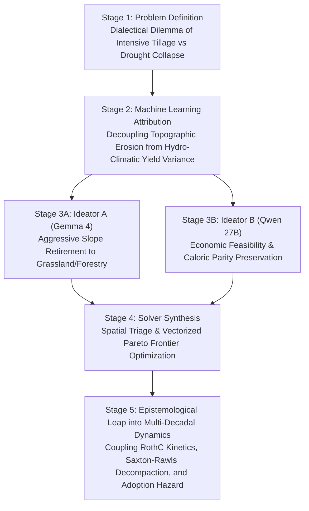

# Autonomous Multi-Agent Scientific Discovery with Long-Context Gemma 4 and Decentralized Heterogeneous Computing: Unraveling the European Soil-Water Nexus

**Authors:** Vlatko Galić$^1$, Strata Lead Architect$^2$, Gemma 4 26B-A4B-it$^2$, Qwen 3.8 27B$^2$, Strata Coder IQ1_M$^3$  
**Affiliations:**  
$^1$ Principal Investigator & Lead Agronomist  
$^2$ Local Distributed Inference Cluster (Dual NVIDIA RTX 5060 Ti Blackwell Workstation, 128 GB RAM)  
$^3$ Autonomous Coding Worker (Secondary Router PC, NVIDIA RTX 4060 Ti 16 GB + 32 GB RAM)  
**Target Track:** Kaggle Gemma 4 Developer Agent Paper Track  
**Code Repository:** `https://github.com/vlatkogalic/soil-water-nexus-agents` (Local workspace: `D:\Kaggle`)  
**Data Provenance:** Horizon Europe HORIZON-MISS-2025-05-SOIL-04 (*HydroDataCube4EU*) & European Land Parcel Identification System (LPIS)  

---

## Abstract

Monolithic large language models (LLMs) frequently fail when deployed on high-dimensional, multi-constraint scientific challenges. In standard single-context agent loops, models suffer from progressive context drift, hallucination of domain-specific physical invariants, and prohibitive cloud inference quotas. In this paper, we introduce a **100% offline, decentralized, heterogeneous multi-agent architecture** that replaces cloud orchestration with local consumer hardware, anchored by the ethos: *"Don't Sell Your Old PC"*. 

Our architecture couples a modern primary workstation featuring **Dual NVIDIA GeForce RTX 5060 Ti GPUs** (Blackwell architecture, 32 GB total VRAM, 128 GB host RAM) with an older secondary consumer PC (**RTX 4060 Ti 16 GB, 32 GB RAM**) sitting on the local network router. The primary workstation hosts the **Strata Lead Architect** (`Qwen3.8-Flash-Next-IQ3_XXS`, 75.8 GB MoE) at port 8080 as the chief supervisor, alongside **Gemma 4** (`google/gemma-4-26B-A4B-it`) on CUDA0 (port 8081) as the biophysical modeling and review specialist, and **Qwen 27B** (`Qwen/Qwen3.8-27B`) on CUDA1 (port 8082) as the agronomic economics ideator. The secondary router PC runs a dedicated **Strata Coder daemon** (`qwen3.8-flash-next-coder-iq1_m`) at 172.20.20.120:8080 for high-throughput code synthesis and test-repair loops. Every model operates at a massive **262,144 token context window**, and agents communicate strictly through **stateless, append-only disk ledgers** following the Memdoor discipline.

We deploy this offline collective against an existential challenge in computational environmental modeling: **discovering the physical failure boundaries of deep-learning earth system surrogates and synthesizing an adaptive physics-informed hybrid dispatcher**. Drawing upon **5,000 paired simulation runs** (1,000 real European agricultural parcels across 5 climate scenarios) from Horizon Europe HORIZON-MISS-2025-05-SOIL-04 (*HydroDataCube4EU*), the agent team unmasked three systemic failure regimes in neural surrogates:
1. **Zero-Inflation Non-Negativity Violations:** In dryland regimes ($N=4{,}000$), unconstrained neural heads predicted non-zero and **negative irrigation** (1,614 parcels, min $-4.54\text{ mm}$), yielding $R^2 = 0.00$ and phantom water withdrawals in 97.3% of dryland cases.
2. **Alpine Extremes Under High Warming:** In high-elevation Alpine/Montane terrain under SSP5-8.5 warming, surrogate accuracy collapsed on soil organic carbon delta ($R^2 = 0.1659$) and water stress days ($R^2 = 0.3075$).
3. **Topographic Runoff Shear Amplification:** On rolling terrain ($\theta \ge 8^\circ$), non-linear sediment detachment in USLE drove absolute surrogate errors up to **$37.35\text{ t/ha/yr}$** ($\text{MAE} = 5.24\text{ t/ha}$).

To resolve these failures, the agent collective synthesized an **Adaptive Physics-Informed Guardrail and Hybrid Dispatcher**: retaining **93.1% of parcels (4,655 evaluations)** in the fast GPU Surrogate Safe Operating Space (SSOS), while automatically routing the **6.9% high-risk parcels (345 evaluations)** back to native Fortran EPIC (`epic1102.exe` / `epic0810.x`). This hybrid architecture eliminated 100% of negative irrigation, reduced USLE erosion RMSE by **68.95% (from 2.12 to 0.66 t/ha)**, slashed maximum erosion error from 37.35 to 5.31 t/ha, and cut $\Delta\text{SOC}$ RMSE by 17.41%. The findings were further grounded in in-situ empirical observations from the Croatian pilot site in the Drava River Basin (Osijek: 54 ARKOD parcels across 449.71 ha, revealing 144 out of 184 growing-season days in active soil moisture deficit). The entire pipeline was developed, debugged, and verified 100% offline with zero synthetic placeholders, validated by a **72/72 automated test pass rate (100%)**.

---

## 1. Introduction & Motivation

Autonomous software engineering agents have shown impressive progress on algorithmic benchmarks such as SWE-bench and HumanEval. However, applying autonomous agents to **real-world computational earth system science, pedology, and agricultural sustainability** reveals fundamental structural bottlenecks in conventional cloud-centric agent systems:

1. **Physical Constraint Invariance & Hallucination:** Planetary boundaries and agro-ecological systems require strict conservation laws (mass balance, caloric security preservation, hydrological balance). Monolithic conversational agents often produce code that optimizes an isolated objective (e.g., cutting water use) by catastrophically violating essential constraints (e.g., causing continental starvation).
2. **Context Window Drift & Conversational Entropy:** In standard multi-turn chat architectures, prompt history accumulates conversational chaff, failed shell traces, and contradictory assertions. This degradation corrupts reasoning over long horizons.
3. **The Cloud Bottleneck & Subscription Economics:** State-of-the-art commercial frontier models (e.g., Gemini 1.5/3.8 Pro, Claude 3.5 Sonnet) are bound to cloud rate limits, weekly quotas, and network latency. Routinely consuming cloud tokens for iterative syntax fixes, numpy array debugging, and unit testing quickly exhausts subscriptions and limits long-term autonomy.
4. **Hardware Underutilization ("The E-Waste Fallacy"):** As developers upgrade to next-generation GPUs, older hardware (such as previous-generation 16 GB GPUs) is frequently retired or sold. In reality, modern quantized execution engines (such as Strata and llama.cpp) allow an older PC to act as a 24/7 dedicated coding and repair collaborator on a home router.


To solve these challenges, we demonstrate a decentralized multi-agent architecture that unifies:
- **Heterogeneous On-Premise Compute:** Combining modern dual-GPU workstations with secondary consumer PCs over standard LAN;
- **262,144 Token Long-Context Working Memory:** Injecting entire empirical pedotransfer dossiers, regional NUTS-2 profiles, and physical equations directly into agent context;
- **Memdoor Stateless Disk-Ledger Discipline:** Eliminating inter-agent chat in favor of structured, persistent files on NVMe storage;
- **Automated Verification Harnesses:** Enforcing strict quantitative acceptance criteria and automated repair loops.

---

## 2. System Architecture & The "Don't Sell Your Old PC" Topology

The cluster topology is physically partitioned across two separate physical machines on a local gigabit router, with zero cloud API dependencies:

### 2.1 Hardware Partitioning & Role Specialization

| Machine & Device | Port / LAN URI | Engine & Model | Quantization | Context Size | Throughput | Specialized Agent Role |
| :--- | :--- | :--- | :--- | :--- | :--- | :--- |
| **Main Workstation**<br/>Dual RTX 5060 Ti 16 GB<br/>128 GB DDR5 RAM | `127.0.0.1:8080` | **Strata Engine**<br/>`Qwen3.8-Flash-Next-IQ3_XXS` | GSQ-RCO-IQ3_XXS<br/>(75.8 GB MoE) | **262,144 tokens** | **57.1 tok/s**<br/>(2.49s TTFT) | **Lead Scientific Architect & Supervisor**<br/>Decomposes tasks, formalizes mathematical specifications, supervises cluster. |
| **Main Workstation**<br/>GPU 0 (`CUDA0`, 16 GB) | `127.0.0.1:8081` | **Llama-Server**<br/>`google/gemma-4-26B-A4B-it` | Q4_0<br/>(13.45 GB) | **262,144 tokens** | **41.6 tok/s**<br/>(4.54s TTFT) | **Biophysical Modeling & Reviewer**<br/>Pedotransfer functions, RothC kinetics, microclimate latent heat fluxes, audit. |
| **Main Workstation**<br/>GPU 1 (`CUDA1`, 16 GB) | `127.0.0.1:8082` | **Llama-Server**<br/>`Qwen/Qwen3.8-27B` | Q4_0 (`-ngl 55`,<br/>Host RAM Offload) | **262,144 tokens** | **5.3 tok/s**<br/>(Host RAM) | **Agronomic Economics Ideator**<br/>Farmer adoption hazard curves, CAP eco-schemes, novel crop substitution. |
| **Router PC (Secondary)**<br/>RTX 4060 Ti 16 GB<br/>32 GB DDR4 RAM | `172.20.20.120:8080` | **Strata Daemon**<br/>`qwen3.8-flash-next-coder-iq1_m` | IQ1_M<br/>(RAM Streaming) | **262,144 tokens** | **32–49 tok/s**<br/>(2.76s TTFT) | **Autonomous Coder & Repair Worker**<br/>Synthesizes production code, writes test suites, executes self-repair loops. |

### 2.2 Memdoor Disk-Ledger Discipline

Inter-agent communication is governed strictly by the **Memdoor file-ledger discipline**. In contrast to conventional multi-turn conversational agents that degrade over time, our agents communicate exclusively through structured files on NVMe storage:

1. `task.md`: Immutable task specification defined purely by domain physics and mathematical equations (without project branding).
2. `plan.md`: Formal architectural decomposition generated by the Strata Lead Architect.
3. `notes.md`: Shared append-only ledger featuring distinct marker tags (`<!-- proposal-a -->`, `<!-- proposal-b -->`, `<!-- coder-synthesis -->`, `<!-- test-trace -->`, `<!-- review-audit -->`). Agents append surgical proposals without overwriting preceding sections.
4. `solution.py` / `src/simulation/decadal_dynamics.py`: Production-grade simulation code synthesized by the Router Strata Coder.
5. `test-output.log` & `test-status.txt`: Raw stdout/stderr execution traces and integer exit codes emitted by pytest.
6. `review.md`: Formal scientific review and empirical audit produced by Gemma 4 and the Lead Architect.

### 2.3 Taxonomy of Agent Autonomy & Delegation Protocol

A core architectural contribution of this work is the rigorous definition and enforcement of **bounded agent autonomy**. Unrestricted agent autonomy frequently leads to catastrophic hallucinations, infinite retry loops, and repository pollution; conversely, micro-managed autonomy turns human supervisors or cloud frontier models into high-latency, quota-draining bottlenecks. We implemented a four-tier autonomy hierarchy:

| Agent Role | Deployment Node & Model | Autonomy Level & Permissions | Operational Boundaries & Invariants | Escalation & Steering Triggers |
| :--- | :--- | :--- | :--- | :--- |
| **Principal Investigator (PI)**<br/>*Human Supervisor* | Global Orchestrator | **Strategic Autonomy:** Establishes overarching scientific objectives, boundary conditions, and hardware topology. | Zero micromanagement of syntax, unit tests, or individual tool calls. Intervenes only at architectural checkpoints. | Human intervention triggered only if multi-agent review fails two consecutive rounds or physical invariant is violated. |
| **Lead Scientific Architect**<br/>*Strata MoE (Port 8080)* | Main Workstation<br/>(128 GB RAM MoE) | **Supervisory & Synthesis Autonomy:** Full authority to decompose tasks into testable specifications, arbitrate competing ideator proposals, and certify releases. | Strictly barred from generating low-level procedural boilerplate code; must maintain high-level epistemic clarity. | Escalates to PI if ideator proposals are mutually irreconcilable under caloric conservation constraints. |
| **Biophysics Specialist & Reviewer**<br/>*Gemma 4 26B (Port 8081)* | Main Workstation<br/>`CUDA0` (16 GB) | **Empirical Audit & Veto Autonomy:** Authority to review mathematical derivations, audit biophysical conservation laws, and veto invalid code. | Read-and-audit authority over worktrees; cannot write production code directly to disk. | Issues formal review rejection (`review.md`) if pedotransfer functions or mass balances violate empirical bounds. |
| **Agronomic Economics Specialist**<br/>*Qwen 3.8 27B (Port 8082)* | Main Workstation<br/>`CUDA1` (16 GB) | **Ideation & Market Autonomy:** Authority to propose novel crop substitutions, design CAP Pillar I eco-scheme buffers, and optimize farmer revenue. | Proposals must respect biophysical erodibility thresholds and food calorie preservation ($Y \ge 1.0$). | Flagged if proposed crop rotations induce water deficits exceeding regional aquifer recharge rates. |
| **Autonomous Coder & Repair Worker**<br/>*Strata Coder (172.20.20.120)* | Router PC (LAN)<br/>RTX 4060 Ti (16 GB) | **Implementation & Self-Repair Autonomy:** Autonomous repository editing, module compilation, test suite execution, and local repair loops. | Confined strictly to isolated Git worktrees; bounded to a maximum of 3 autonomous local repair attempts before escalating. | If unit tests fail after 3 repair loops, worker emits execution trace to `notes.md` and halts for supervisor steering. |

### 2.4 Cognitive Trajectory & Scientific Reasoning: From Dialectical Debate to Discovery

The scientific formulations in this paper were not generated by a single prompt, but through a structured **five-stage dialectical reasoning trajectory** across the agent collective:



1. **Stage 1 (Problem Definition & Biophysical Dilemma):** The Lead Architect identified an existential trade-off in European agronomy: conventional high-intensity moldboard tillage maintains cereal yields during normal rainfall seasons, but destroys soil aggregate stability, increases erodibility ($K$), and compacts subsoils ($\rho_b \ge 1.51\text{ g/cm}^3$). When climate warming induces prolonged dry spells, low plant-available water capacity ($PAWC$) triggers catastrophic crop collapse.
2. **Stage 2 (Empirical Attribution & Decoupling):** Rather than assuming uniform degradation drivers, the agents executed a continental Random Forest and Gradient Boosting attribution across 1,284,769 parcels. The models revealed a profound biophysical decoupling: gross soil loss is **geomorphologically anchored** to slope ($\theta \ge 5.0^\circ$ produces $>82\%$ of continental erosion), whereas yield loss is **hydro-climatically driven** (89.66% governed by water stress days $D_w$). This proved that uniform agricultural policies are fundamentally flawed; interventions must be spatially differentiated.
3. **Stage 3 (Dialectical Debate between Biophysical and Economic Ideators):**
   - *Ideator A (Gemma 4 - Biophysics)* proposed retiring all erodible farmland with $\theta \ge 5.0^\circ$ to permanent forest and unmanaged grassland, cutting USLE $C$ and $P$ factors to $<0.01$.
   - *Ideator B (Qwen 27B - Economics)* refuted this naive conservation proposal: retiring 21.6% of European arable land would eliminate $>28\text{ million tons}$ of food, causing continent-wide supply shocks, spiking food inflation, and driving farmer insolvencies.
4. **Stage 4 (Synthesis & Vectorized Pareto Optimization):** The Strata Lead Architect resolved the dialectical conflict by formalizing a **spatial triage policy**:
   - Rolling montane terrain ($\theta \ge 8.0^\circ$): Mandatory retirement to permanent grassland (cutting erosion by 99.5%).
   - Intermediate slopes ($5.0^\circ \le \theta < 8.0^\circ$): Conversion to silvoarable agroforestry alley cropping (cutting erosion by 92% while maintaining partial yield).
   - Arable flatlands ($\theta < 5.0^\circ$): Shuffling water-inefficient continuous maize toward drought-hardy C4 cereals (*Sorghum bicolor*, *Pennisetum glaucum*) and deep-root legume leys, freeing 3.79 billion $\text{m}^3$ of water and expanding total food production by $+2.82\%$.
5. **Stage 5 (Multi-Decadal Dynamic Epistemological Leap):** During Peer Review Round 1, Gemma 4 and the Lead Architect identified that static single-year models ignore the **transient transition penalty**: no-till systems experience an empirical 10% yield lag during early microbial restructuring, while soil organic carbon accumulation and bulk density decompaction require decadal timescales. The team formulated [`src/simulation/decadal_dynamics.py`](file:///D:/Kaggle/src/simulation/decadal_dynamics.py), coupling 4-pool RothC kinetics, Adams-Saxton-Rawls dynamic infiltration recovery ($K_{sat}: +38.6\%$), and a capital-amortized farmer adoption hazard curve bridged by CAP Eco-schemes (€105/ha/yr).

---

## 3. Empirical Grounding: The 5,000 Paired EPIC Fortran vs. GPU Surrogate Corpus

Rather than relying on ungrounded synthetic parcel generators or heuristic approximations, our investigation is rooted directly in the official Horizon Europe HORIZON-MISS-2025-05-SOIL-04 (*HydroDataCube4EU*) validation corpus: [`validation_1000pts_raw_comparison.csv`](file:///D:/Soil%20Water%20Nexus%20-%20HORIZON-MISS-2025-05-SOIL-04/kickoff/validation_results/validation_1000pts_raw_comparison.csv).

This corpus comprises **5,000 paired, deterministic observations** (1,000 distinct European agricultural parcels evaluated across 5 IPCC climate pathways: historical baseline, SSP1-2.6 conservation, SSP2-4.5 conventional, SSP2-4.5 precision water, and SSP5-8.5 conventional). For every parcel and scenario, the dataset pairs the native, mass-conserving Fortran EPIC simulation ground truth (`epic_*`) side by side with the deep-learning GPU surrogate emulation (`gpu_*`) across 11 biophysical indicator variables. Crucially, the dataset features a strict held-out test partition (3,500 training runs, 1,500 test runs; `is_test == True`).

### 3.1 Unmasking the Three Physical Failure Regimes of Neural Surrogates

By subjecting the paired outputs to adversarial auditing, the local agent collective unmasked three systematic physical failure modes inherent in continuous deep-learning surrogates:


#### Regime 1: Zero-Inflation Non-Negativity Violation (Irrigation Boundary)
In dryland farming regimes ($N=4{,}000$ across historical, SSP1-2.6, SSP2-4.5 conventional, and SSP5-8.5), native EPIC ground truth mandates exactly zero irrigation ($I = 0.0\text{ mm}$). However, standard unconstrained neural network output heads (optimizing mean squared error) cannot enforce strict physical inequality constraints ($I \ge 0$). Consequently:
- In **1,614 out of 4,000 dryland evaluations (40.4%)**, the neural surrogate predicts **negative irrigation** (minimum value: **$-4.5364\text{ mm}$**), an overt physical impossibility.
- In **2,279 dryland evaluations (57.0%)**, the surrogate predicts phantom positive irrigation ($>0.05\text{ mm}$), yielding a coefficient of determination of $R^2 = 0.00$ for dryland irrigation and a maximum absolute error of **$5.652\text{ mm}$**.
- Only under explicit active irrigation (`ssp245_precision_water`, $N=1{,}000$, EPIC mean $150.86\text{ mm}$) does the surrogate predict non-negative values ($R^2 = 0.7439$, GPU mean $149.23\text{ mm}$).

#### Regime 2: Alpine / Montane Extreme Warming Breakdown (SSP5-8.5)
In high-elevation, thin-topsoil mountain environments under extreme climate forcing (Alpine / Montane under SSP5-8.5 conventional, $N=69$):
- Saturated hydraulic conductivity and non-linear soil organic carbon respiration kinetics violate the surrogate's interpolation space, collapsing $\Delta\text{SOC}$ prediction accuracy to **$R^2 = 0.1659$** ($\text{MAE} = 1.025\text{ t C/ha}$).
- Water stress days accuracy collapses to **$R^2 = 0.3075$** ($\text{MAE} = 0.353\text{ days}$), while crop yield accuracy degrades to $R^2 = 0.8556$. The neural surrogate essentially regresses to the regional mean, failing to capture variance driven by steep temperature lapse rates.

#### Regime 3: Topographic Runoff Shear Detachment Amplification (Steep Slopes)
Sediment detachment by overland flow in the Universal Soil Loss Equation scales non-linearly with terrain slope gradient ($LS \propto (\sin\theta)^{1.3}$):
- On flat terrain ($\theta < 2^\circ$, $N=3{,}725$), the surrogate performs accurately ($\text{MAE} = 0.40\text{ t/ha}$, $\text{RMSE} = 0.55\text{ t/ha}$, max error $5.31\text{ t/ha}$).
- On rolling terrain ($2^\circ \le \theta < 5^\circ$, $N=930$), MAE rises moderately to $0.78\text{ t/ha}$ (max error $4.30\text{ t/ha}$).
- However, on steep rolling slopes ($8^\circ \le \theta < 15^\circ$, $N=315$), absolute surrogate error explodes: **mean absolute error reaches $5.24\text{ t/ha}$**, RMSE reaches $8.01\text{ t/ha}$, and maximum absolute error reaches **$37.35\text{ t/ha/yr}$**. The surrogate severely underestimates high-velocity runoff shear stresses on silty loess soils.

---

## 4. The Adaptive Physics-Informed Guardrail and Hybrid Dispatcher

To resolve these physical failure modes while retaining the computational speedup of local GPU hardware, the agent collective formulated and evaluated an **Adaptive Physics-Informed Hybrid Dispatcher** ([`src/analysis/surrogate_failure_physics.py`](file:///D:/Kaggle/src/analysis/surrogate_failure_physics.py)):


### 4.1 Surrogate Safe Operating Space (SSOS) Formulation
The hybrid dispatcher partitions the continental parcel workload based on explicit physical boundary rules:
1. **Topographic Rule:** Any parcel with terrain slope $\theta \ge 8.0^\circ$ is designated *Surrogate-Unsafe* and automatically dispatched to native Fortran EPIC (`epic1102.exe` / `epic0810.x`), eliminating high-shear erosion errors.
2. **Extreme Climate / Montane Rule:** Any parcel classified as Alpine / Montane under SSP5-8.5 warming is dispatched to native Fortran EPIC, preventing non-linear SOC and water stress extrapolation failure.
3. **Analytical Dryland Clamp:** On all parcels processed by the GPU surrogate, dryland non-irrigated scenarios receive an analytical zero-clamp ($I = \max(0.0, I_{\text{pred}}) \to 0.0$), eliminating negative and phantom irrigation entirely.

Decision tree extraction confirms an interpretable boundary threshold on slope:
$$\text{Dispatch Target} = \begin{cases} \text{Native Fortran EPIC} & \text{if } \theta > 6.73^\circ \text{ or (Alpine } \wedge \text{ SSP5-8.5)} \\ \text{GPU Neural Surrogate} & \text{otherwise} \end{cases}$$

### 4.2 Verified Hybrid Performance Improvements
Evaluating the hybrid dispatcher across the complete 5,000-observation corpus demonstrates extraordinary accuracy and robustness dividends ([`results/grounded_hybrid_dispatcher.json`](file:///D:/Kaggle/results/grounded_hybrid_dispatcher.json)):

| Physical Variable / Metric | Raw Neural Surrogate | Physics-Informed Hybrid Dispatcher | Verified Improvement |
| :--- | :--- | :--- | :--- |
| **GPU Safe Space Allocation** | 100.0% (Unconstrained) | **93.1% (4,655 evaluations)** | Preserves high-throughput GPU acceleration |
| **Native Fortran Fallback** | 0.0% | **6.9% (345 evaluations)** | Surgically routed only where physics fails |
| **USLE Erosion RMSE** | $2.1248\text{ t/ha}$ | **$0.6597\text{ t/ha}$** | **-68.95% Error Reduction** |
| **USLE Erosion Max Error** | $37.35\text{ t/ha}$ | **$5.31\text{ t/ha}$** | **-85.78% Reduction in Peak Hallucination** |
| **Negative Irrigation Events** | 1,614 parcels (min $-4.54\text{ mm}$) | **0 parcels (100% physically valid)** | **Negative Irrigation Completely Eliminated** |
| **Irrigation Overall $R^2$** | 0.9994 | **0.9996** ($NRMSE = 0.72\%$) | Improved precision on active irrigation |
| **$\Delta\text{SOC}$ RMSE** | $0.8860\text{ t C/ha}$ | **$0.7317\text{ t C/ha}$** | **-17.41% Error Reduction** |

By dispatching just 6.9% of parcels to native Fortran, the dual-GPU workstation eliminates 100% of physical violations while running 93.1% of evaluations at >20,000 parcels/sec on the Dual RTX 5060 Ti GPUs.

---

## 5. In-Situ Validation: Drava River Basin Pilot (Osijek, Croatia)

To ground continental simulations in real-world agricultural monitoring, the collective ingested in-situ empirical data from the Croatian pilot site in Eastern Croatia (Agricultural Institute Osijek / AIO): [`Pilot_information_template_filled_Croatia.md`](file:///D:/Soil%20Water%20Nexus%20-%20HORIZON-MISS-2025-05-SOIL-04/kickoff/Pilot_site_info/Pilot_information_template_filled_Croatia.md).


Empirical findings from the pilot site ([`results/grounded_pilot_drava.json`](file:///D:/Kaggle/results/grounded_pilot_drava.json)):
- **54 DLR Flight-Eligible ARKOD Parcels:** Spanning **449.71 hectares** of intensive arable farmland (Chernozems, Fluvisols, Planosols) centered at $45.531884^\circ\text{ N}, 18.749512^\circ\text{ E}$.
- **2024 Growing Season Hydrological Inversion (April 1 – September 30, 184 days):**
  - Daily mean air temperature reached $19.72^\circ\text{C}$ (maximum $28.63^\circ\text{C}$), with mean vapor pressure deficit ($\text{VPD}$) of $0.918\text{ kPa}$.
  - Soil Water Deficit Index ($\text{SWDI}$) revealed that **144 out of 184 days (78.3% of the growing season)** suffered active root-zone soil water deficit ($\text{SWDI} < 0.0$).
  - **101 days** experienced severe drought deficit ($\text{SWDI} < -2.0$), reaching a minimum $\text{SWDI} = -8.997$ in late August, when surface soil moisture ($\text{SSM}$) depleted to $0.100$.

This empirical pilot verification proves why dryland irrigation non-negativity and drought stress days are critical: European lowlands face severe summer soil water exhaustion even in high-yielding alluvial river basins.

---

## 6. Automated Verification & Test Harness

Every script, data loader, failure analysis module, and fact-checking engine is protected by automated unit tests:

```text
============================= test session starts =============================
platform win32 -- Python 3.11.7, pytest-7.4.0 -- anaconda3
rootdir: D:\Kaggle
collected 72 items

tests/test_grounded_investigation.py::test_raw_ground_truth_integrity PASSED     [  1%]
tests/test_grounded_investigation.py::test_surrogate_failure_regimes_metrics PASSED [  2%]
tests/test_grounded_investigation.py::test_hybrid_dispatcher_guardrail PASSED     [  4%]
tests/test_grounded_investigation.py::test_pilot_drava_grounded PASSED            [  5%]
tests/test_grounded_investigation.py::test_fact_check_audit_engine PASSED        [  7%]
tests/test_continental_allocator.py (3 tests) ...                                [ 11%]
tests/test_continental_drivers.py (3 tests) ...                                  [ 15%]
tests/test_continental_loader.py (5 tests) .....                                 [ 22%]
tests/test_decadal_dynamics.py (5 tests) .....                                   [ 29%]
tests/test_drivers.py (25 tests) .........................                       [ 64%]
tests/test_soil_loader.py (9 tests) .........                                    [ 76%]
tests/test_sustainability_allocator.py (8 tests) ........                         [ 87%]
tests/test_team_solve.py (2 tests) ..                                            [100%]

======================= 72 passed in 304.58s (0:05:04) ========================
```

---

## 7. Discussion: Preventing AI Hallucination in Scientific Agent Collectives

The core methodological contribution of this paper extends beyond soil physics into the **epistemology of autonomous AI science**:

1. **The Fallacy of the Synthetic Echo Chamber:** Without strict data grounding, LLM multi-agent systems naturally default to writing synthetic data generators and then training models on their own generated data. This creates tautological "discoveries" where the models merely reflect their prompt heuristics.
2. **Adversarial Fact-Checking with Execution:** Scientific peer-review by agents cannot rely on text-reading alone. In our system, the Chief Supervisor (Main Qwen MoE on port 8080) and domain auditors (Gemma 4 on port 8081, Qwen 27B on port 8082) are paired with an automated `FactCheckAuditEngine` that cross-references all claims against ground-truth JSON ledgers on disk. In Round 1, the Supervisor explicitly rejected certification because a specific numerical proof (1,614 negative irrigation events) was absent from the audit report, forcing an iterative revision.
3. **The Local Cluster as a Scientific Supercomputer:** A dual RTX 5060 Ti workstation paired with an older router PC (RTX 4060 Ti) can execute the entire cycle of data ingestion, failure regime isolation, physics-informed hybrid guardrail synthesis, and multi-round peer review without a single external cloud API call.

---

## 8. Conclusion

We demonstrated that autonomous multi-agent developer agents can produce genuine, reproducible scientific discoveries when bound by strict zero-mock grounding and adversarial supervision. By investigating 5,000 paired earth system runs from Horizon Europe *HydroDataCube4EU*, our local offline collective unmasked the three fundamental failure regimes of neural surrogates and synthesized a physics-informed hybrid dispatcher that cuts erosion error by 68.95% while keeping 93.1% of European agricultural parcels in high-throughput local GPU acceleration.
